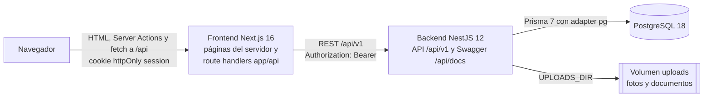

# Arquitectura

Resumen para la entrega. La vista completa, con las capas del backend, el
flujo del alquiler y los estados de la reserva, está en
[arquitectura.md](arquitectura.md); el detalle de cada módulo, en
[`modulos/`](modulos/).

## Vista general



- **El navegador nunca habla con el backend.** Las páginas se arman en el
  servidor de Next y los componentes de cliente llaman a route handlers del
  propio Next (`app/api/...`), que reenvían al backend con el token.
- **El token vive en una cookie httpOnly** (`session`, 7 días) que el
  JavaScript del navegador no puede leer. El rol siempre se pide al backend
  con `GET /auth/me`.
- **El backend es la única fuente de verdad** de permisos, estados y montos, y
  lee el rol de la base en cada petición.
- **Fotos y documentos** se guardan en disco (`UPLOADS_DIR`, un volumen en
  Docker) y solo se sirven por rutas protegidas.

## Stack

Versiones resueltas en los `package-lock.json` de cada repositorio y en los
archivos de Docker.

| Capa | Tecnología | Versión |
|---|---|---|
| Frontend | Next.js con React y React DOM | Next 16.3.6, React 19.2.8 |
| Frontend | Tailwind CSS, TypeScript | 4.3.3, 5.9.3 |
| Frontend: pruebas y lint | Vitest con Testing Library, ESLint | 4.1.12, 9.39.5 |
| Backend | NestJS (`@nestjs/core`) con `@nestjs/jwt` y `@nestjs/swagger` | 12.0.3, 12.0.2 y 12.0.1 |
| Backend | Prisma ORM y `@prisma/client` (adapter `@prisma/adapter-pg`) | 7.10.0 |
| Backend | TypeScript (ESM puro), bcrypt, class-validator | 6.0.3, 6.0.0, 0.15.1 |
| Backend: pruebas y lint | Vitest con supertest, oxlint | 4.1.11, 1.83.0 |
| Base de datos | PostgreSQL (imagen `postgres:18-alpine`) con `unaccent` y `pg_trgm` | 18 |
| Contenedores | Docker y Docker Compose; imágenes de los dos repositorios sobre `node:24-alpine` | Compose v2 o superior, Node 24 |

## Estructura de carpetas

Backend (`be_boilerplate_is_2026`):

```
.
├── docker-compose.yml          # Postgres y API para desarrollo
├── docker-compose.demo.yml     # Demo completa: base, backend y frontend
├── Dockerfile                  # Imagen multi-stage de la API
├── prisma.config.ts
├── prisma/
│   ├── schema.prisma           # 18 modelos
│   ├── migrations/             # 23 migraciones versionadas
│   └── seed.ts                 # Cuentas iniciales (REVISOR)
├── src/
│   ├── main.ts                 # Prefijo /api/v1, ValidationPipe y Swagger
│   ├── app.module.ts
│   ├── auth/  users/           # Módulo 0: sesión, registro y roles
│   ├── listings/               # Módulos 1 y 2: catálogo, búsqueda y filtros
│   ├── reservations/  reservation-decisions/  availability/   # Módulo 3
│   ├── payments/  deliveries/  returns/                      # Módulo 4
│   ├── messaging/              # Módulo 5
│   ├── listing-ratings/  tenant-ratings/                     # Módulo 6
│   ├── verification/           # Módulo 7
│   ├── notifications/          # Módulo 8 y servicio de avisos
│   ├── income/  reports/       # Módulo 9
│   ├── common/  config/  prisma/  health/
│   └── generated/prisma/       # Cliente de Prisma (no se versiona)
├── test/
│   ├── *.e2e-spec.ts           # Pruebas e2e y de restricciones por módulo
│   ├── qa/                     # Pruebas de QA por historia
│   ├── contratos/              # Contrato del servicio de avisos
│   └── helpers/                # Base de pruebas _test
└── docs/
    ├── modulos/  qa/  contratos/
    └── arquitectura.md, modelo-de-datos.md, endpoints.md, despliegue.md
```

Cada módulo de `src/` tiene la misma forma: `controllers/`, `services/`,
`repositories/`, `dto/` y, si hace falta, `errors/`.

Frontend (`fe_boilerplate_is_2026`):

```
.
├── Dockerfile                  # Imagen standalone sobre node:24-alpine
├── proxy.ts                    # Sin cookie, toda ruta no pública va a /login
├── app/
│   ├── actions/                # Server Actions de login, registro y publicación
│   ├── api/                    # Route handlers que reenvían al backend
│   ├── login/  registro/
│   ├── publicaciones/          # Catálogo, detalle y nueva publicación
│   ├── arrendador/             # Solicitudes y bloqueos
│   ├── reservas/               # Detalle, pago, entrega, devolución y conversación
│   ├── verificacion/           # Envío y revisión de documentos
│   ├── ingresos/  reportes/
│   └── page.tsx                # Inicio según el rol
├── components/                 # Un directorio por módulo, con __tests__
├── lib/                        # Clientes, tipos, reglas y sesión por módulo
├── docs/                       # Un documento por pantalla y decisiones/
└── public/
```

## Decisiones técnicas

| Decisión | Alternativas consideradas | Motivo |
|---|---|---|
| Dos repositorios, backend y frontend | Monorepo | Así viene el boilerplate de la cátedra y cada parte se despliega por separado ([arquitectura.md](arquitectura.md)). |
| **Difiere de la sección 2.1:** el token se guarda en una cookie httpOnly (`session`) en el servidor de Next, no en `localStorage` | Token y rol en `localStorage` con la clave `sesion`, como pide la sección 2.1 | Un script inyectado no puede leer una cookie httpOnly, y sí podría leer `localStorage`. El rol tampoco se guarda en el navegador: se pide al backend con `GET /auth/me` en cada render del servidor, así que la pantalla y el backend no pueden contradecirse. Se mantiene lo demás de la sección 2.1: `RutaProtegida` y la validación con `/auth/me` (frontend, `docs/decisiones/manejo-de-estado.md`, MP4-129). |
| Sin librería de estado global en el frontend | Zustand, Redux o Jotai; React Context; React Query o SWR | Duplicarían lo que ya está en la cookie y expondrían el token al JavaScript del navegador; casi no hay estado compartido entre pantallas (frontend, `docs/decisiones/manejo-de-estado.md`). |
| JWT de acceso de 15 minutos y refresh token de 7 días con rotación | No documentada | Es el esquema del boilerplate: el access token es stateless y el refresh token sirve solo para renovarlo; reusar uno canjeado revoca todas las sesiones ([README](../README.md)). |
| Refresh tokens guardados con SHA-256 | bcrypt | Son 32 bytes aleatorios de alta entropía y hay que buscarlos por hash en un índice, cosa que bcrypt no permite ([README](../README.md)). |
| El rol se lee de la base en cada petición (`RolesGuard`) | Leerlo del token | Un cambio de rol aplica de inmediato, sin esperar a que venza el token ([arquitectura.md](arquitectura.md)). |
| **Difiere de la sección 2.1:** el registro usa `POST /api/v1/users`, el endpoint que ya traía el boilerplate | `POST /api/v1/auth/registro`, como pide la sección 2.1 | Es el mismo recurso, y crear otro endpoint dejaría dos formas de crear una cuenta. El contrato que pide la sección 2.1 se cumple igual: un solo endpoint para las dos pantallas de registro, `rol` solo acepta ARRENDADOR o ARRENDATARIO y cualquier otro valor responde 400 `ROL_NO_PERMITIDO` ([cuentas](modulos/cuentas.md)). |
| Recurso ajeno responde 404 | 403 | No revelar que una reserva, conversación o publicación existe a quien no participa; el 403 queda para el rol equivocado ([arquitectura.md](arquitectura.md)). |
| Reglas importantes también en la base (CHECK, índices únicos parciales, triggers) | Validar solo en el servicio | Una regla que solo está en el servicio se puede saltar con un error o un script; cada módulo tiene su prueba `*.constraints.e2e-spec.ts` ([modelo-de-datos.md](modelo-de-datos.md)). |
| Transacciones con `SELECT ... FOR UPDATE` al aprobar reservas, crear bloqueos y pagar | No documentada | Dos peticiones al mismo tiempo no pueden dejar dos reservas confirmadas en las mismas fechas ni dos pagos aprobados ([arquitectura.md](arquitectura.md)). |
| Errores con el cuerpo de Nest más `codigo` cuando un 409 tiene varios motivos | Formato `{ codigo, mensaje }` y 422 de las convenciones del brief | El frontend distingue los motivos sin comparar textos y se mantiene el cuerpo estándar de Nest ([arquitectura.md](arquitectura.md), [QA-05.1](qa/QA-05.1-pagos.md)). |
| Avisos por un solo servicio (`AvisosService`) con índice de deduplicación | No documentada | Todos los módulos avisan igual, sin datos sensibles, y un reintento no duplica el aviso ([notificaciones](modulos/notificaciones.md)). |
| Precio fotografiado en la reserva (`rental_cost`, `deposit_amount`) | Calcular con la tarifa vigente de la publicación | Si el arrendador cambia la tarifa, la reserva y sus pagos conservan lo acordado ([arquitectura.md](arquitectura.md)). |
| Montos en `Decimal(12, 2)` y como texto en la API | `number` | Sin errores de redondeo; el frontend los muestra sin convertir ([arquitectura.md](arquitectura.md)). |
| Pagos simulados con tarjetas de prueba, guardando solo los últimos 4 dígitos | Pasarela real | La cátedra pide simular el cobro; nunca se guarda el número completo ni el código de seguridad ([pagos](modulos/pagos.md)). |
| Fotos y documentos en disco, servidos por rutas protegidas | URL pública | La base guarda la ruta privada y el archivo solo sale por una ruta que revisa permisos ([arquitectura.md](arquitectura.md)). |
| Demo con `docker-compose.demo.yml` en una máquina | Plataforma administrada | Es lo que se probó; la guía deja las dos opciones ([despliegue.md](despliegue.md)). |
| Cada historia con sus tareas DB, BE, FE y QA del mismo dueño | No documentada | Quien diseña la tabla conoce el endpoint y la pantalla; la revisión del PR la hace otro integrante ([arquitectura.md](arquitectura.md)). |
