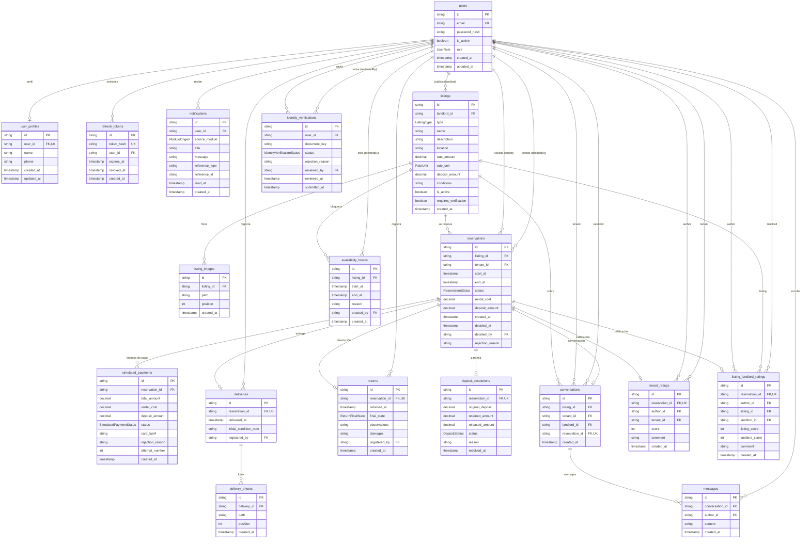

# Modelo de datos

Sale de [`prisma/schema.prisma`](../prisma/schema.prisma): 18 tablas en
PostgreSQL 18, creadas por 23 migraciones. `PK` es la llave primaria, `FK`
una llave foránea y `UK` un valor único. Las relaciones `||--o|` son de 1 a
0..1 y las `||--o{` de 1 a muchos.

Las reglas que viven en la base (CHECK, índices únicos parciales, triggers,
funciones de consulta y extensiones) están en
[modelo-de-datos.md](modelo-de-datos.md), y el detalle de cada tabla, con sus
decisiones, en el documento de su módulo en [`modulos/`](modulos/).

## Diagrama entidad-relación

**Enums**

- `UserRole`: ARRENDADOR, ARRENDATARIO, REVISOR
- `ListingType`: EQUIPO, ESPACIO
- `RateUnit`: HORA, DIA, NOCHE, SEMANA
- `ReservationStatus`: PENDIENTE, CONFIRMADA, RECHAZADA, CANCELADA, EN_CURSO, COMPLETADA
- `SimulatedPaymentStatus`: PENDIENTE, APROBADO, RECHAZADO
- `ReturnFinalState`: SIN_OBSERVACIONES, CON_OBSERVACIONES
- `DepositStatus`: LIBERADA, RETENIDA
- `IdentityVerificationStatus`: PENDIENTE, APROBADA, RECHAZADA
- `ModuloOrigen`: CATALOGO, BUSQUEDA, RESERVAS, PAGOS_GARANTIA, MENSAJERIA, RESENAS, VERIFICACION, NOTIFICACIONES, REPORTES

## Tablas

| Tabla | Descripción | Campos importantes |
|---|---|---|
| `users` | Cuenta de acceso, de la cátedra, con el rol agregado ([cuentas](modulos/cuentas.md)) | `email` único y normalizado, `password_hash` (bcrypt), `is_active`, `role` (por defecto ARRENDATARIO) |
| `user_profiles` | Datos visibles de la cuenta, uno por usuario ([cuentas](modulos/cuentas.md)) | `user_id` único, `name` (hasta 100), `phone` (8 a 15 dígitos) |
| `refresh_tokens` | Sesiones abiertas para renovar el access token | `token_hash` (SHA-256), `expires_at`, `revoked_at` |
| `notifications` | Bandeja de avisos de cada usuario ([notificaciones](modulos/notificaciones.md)) | `user_id`, `source_module`, `title`, `message`, `reference_type` y `reference_id`, `read_at` (nulo = no leída) |
| `listings` | Equipo o espacio publicado por un arrendador ([catalogo](modulos/catalogo.md)) | `landlord_id`, `type`, `rate_amount` y `rate_unit`, `deposit_amount`, `is_active`, `requires_verification` |
| `listing_images` | Fotos de una publicación, en orden ([catalogo](modulos/catalogo.md)) | `listing_id`, `path` privado, `position` única por publicación |
| `reservations` | Solicitud y reserva de un bien en un período ([reservas](modulos/reservas.md)) | `listing_id`, `tenant_id`, `start_at` y `end_at`, `status`, `rental_cost` y `deposit_amount` fotografiados, `decided_by`, `rejection_reason` |
| `availability_blocks` | Fechas que el arrendador bloquea en un bien propio ([reservas](modulos/reservas.md)) | `listing_id`, `start_at` y `end_at`, `reason` opcional, `created_by` |
| `simulated_payments` | Intentos de pago simulado de una reserva, hasta 3 ([pagos](modulos/pagos.md)) | `reservation_id`, `attempt_number` único por reserva, `status`, `total_amount`, `card_last4` (solo los últimos 4 dígitos), `rejection_reason` |
| `deliveries` | Entrega del bien que inicia el alquiler ([entregas](modulos/entregas.md)) | `reservation_id` único, `delivered_at`, `initial_condition_note`, `registered_by` |
| `delivery_photos` | Fotos del estado inicial en la entrega ([entregas](modulos/entregas.md)) | `delivery_id`, `path` privado, `position` única por entrega |
| `returns` | Devolución del bien ([devoluciones](modulos/devoluciones.md)) | `reservation_id` único, `returned_at`, `final_state`, `damages`, `registered_by` |
| `deposit_resolutions` | Resolución simulada de la garantía, que cierra la reserva ([devoluciones](modulos/devoluciones.md)) | `reservation_id` único, `original_deposit`, `retained_amount`, `released_amount`, `status`, `reason` |
| `conversations` | Conversación entre arrendatario y arrendador, antes de reservar o de una reserva ([mensajeria](modulos/mensajeria.md)) | `listing_id`, `tenant_id`, `landlord_id`, `reservation_id` único y opcional |
| `messages` | Mensajes de una conversación ([mensajeria](modulos/mensajeria.md)) | `conversation_id`, `author_id`, `content` (hasta 1000 caracteres) |
| `tenant_ratings` | Calificación del arrendador al arrendatario ([resenas](modulos/resenas.md)) | `reservation_id` único, `author_id`, `tenant_id`, `score` de 1 a 5, `comment` |
| `listing_landlord_ratings` | Calificación del arrendatario al bien y al arrendador ([resenas](modulos/resenas.md)) | `reservation_id` único, `listing_id`, `landlord_id`, `listing_score` y `landlord_score` de 1 a 5, `comment` |
| `identity_verifications` | Solicitudes de verificación de identidad ([verificacion](modulos/verificacion.md)) | `user_id`, `document_key` privado, `status`, `reviewed_by`, `reviewed_at`, `rejection_reason` |
