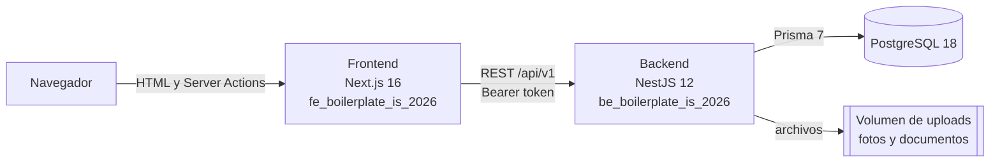
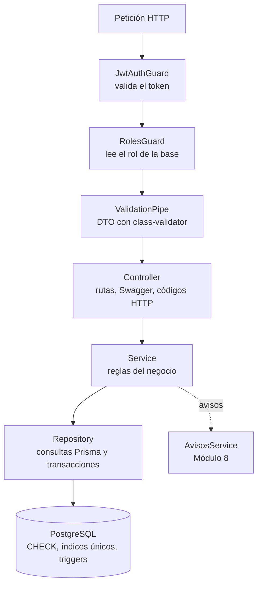
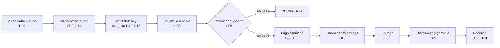
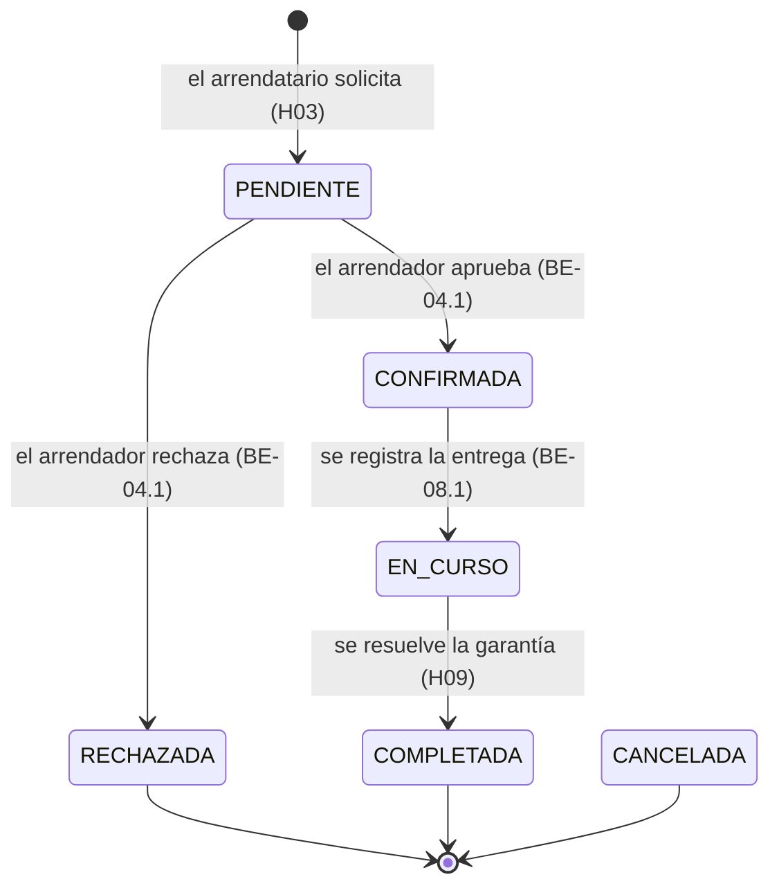

# Arquitectura, flujos y decisiones

Plataforma de renta de equipos y espacios (Proyecto 4, Ingeniería de Software,
UCA). Este documento junta la vista general; el detalle de cada parte está en
el documento de su módulo en [`modulos/`](modulos/).

## Vista general

- **El navegador nunca habla con el backend.** Las páginas se arman en el
  servidor de Next y los componentes de cliente llaman a route handlers del
  propio Next (`app/api/...`), que reenvían al backend con el token. El token
  vive en una cookie httpOnly (ver la decisión de estado en el repositorio del
  frontend, `docs/decisiones/manejo-de-estado.md`).
- **El backend es la única fuente de verdad** de permisos, estados y montos.
  El frontend valida para dar una buena experiencia, pero el backend vuelve a
  validar todo.
- **Las fotos y documentos** se guardan en disco (`UPLOADS_DIR`, un volumen en
  Docker) y solo se sirven por rutas protegidas; la base guarda la ruta
  privada, nunca una URL pública.

## Módulos

| Módulo | Historias | Código (backend) | Documento |
|---|---|---|---|
| 0. Cuentas y roles | H00 | `src/auth`, `src/users` | [cuentas](modulos/cuentas.md) |
| 1. Catálogo | H01, H12 | `src/listings` | [catalogo](modulos/catalogo.md) |
| 2. Búsqueda y filtros | H02, H11 | `src/listings` (H02; H11 en desarrollo) | [catalogo](modulos/catalogo.md) |
| 3. Reservas y disponibilidad | H03, H04, H13, H14 | `src/reservation-decisions`, `src/availability` | [reservas](modulos/reservas.md) |
| 4. Pagos y garantía | H05, H06, H08, H09 | `src/payments`, `src/deliveries`, `src/returns` | [pagos](modulos/pagos.md), [entregas](modulos/entregas.md), [devoluciones](modulos/devoluciones.md) |
| 5. Mensajería | H15, H16 | `src/messaging` | [mensajeria](modulos/mensajeria.md) |
| 6. Reseñas | H17, H18 | (en desarrollo) | [resenas](modulos/resenas.md) |
| 7. Verificación de identidad | H07, H19 | `src/verification` | [verificacion](modulos/verificacion.md) |
| 8. Notificaciones | H10, H20 | `src/notifications` | [notificaciones](modulos/notificaciones.md) |
| 9. Reportes | H21, H22 | `src/income`, `src/reports` | [ingresos](modulos/ingresos.md), [reportes](modulos/reportes.md) |

## Capas del backend

Cada módulo de `src/` sigue la misma forma: `controllers/`, `services/`,
`repositories/`, `dto/` y, si hace falta, `errors/`. Los imports entre
módulos usan alias (`@Messaging/...`, `@Notifications/...`).

## Flujo principal del alquiler

Durante todo el flujo, el Módulo 8 (H20) avisa a la otra persona en cada paso
que la afecta, y el Módulo 9 (H21, H22) reúne los ingresos y la ocupación del
arrendador.

## Estados de una reserva

- Una solicitud **PENDIENTE no ocupa fechas**; **CONFIRMADA y EN_CURSO sí**
  (disponibilidad, H13).
- **CANCELADA** está en el modelo, pero ninguna historia la produce todavía.
- La conversación de la reserva (H16) se escribe en CONFIRMADA y EN_CURSO; en
  los estados finales solo se lee el historial.

## Decisiones y patrones

| Decisión | Por qué |
|---|---|
| **Monorepo no: dos repositorios** (backend y frontend) | Así viene el boilerplate de la cátedra y cada parte se despliega por separado. Los PR que dependen uno del otro se enlazan en la descripción. |
| **Las reglas importantes viven también en la base** (CHECK, índices únicos parciales, un trigger) | Una regla que solo está en el servicio se puede saltar con un error o un script. En la base no. Cada módulo tiene su prueba `*.constraints.e2e-spec.ts` que las verifica. Ver [modelo de datos](modelo-de-datos.md). |
| **El rol se lee de la base en cada petición** (`RolesGuard`), no del token | Si cambia el rol de alguien, el cambio aplica de inmediato y no hay que esperar a que venza el token. |
| **Recurso ajeno = 404**, no 403 | No revelar que una reserva, conversación o publicación existe a quien no participa en ella. El 403 queda para el rol equivocado. |
| **Errores con `codigo`** cuando un 409 puede tener varios motivos | El frontend necesita distinguir, por ejemplo, `CONVERSACION_NO_HABILITADA` de `CONVERSACION_CERRADA`, sin comparar textos. Se mantiene el cuerpo estándar de Nest. |
| **Transacciones con `SELECT ... FOR UPDATE`** en lo que puede chocar (aprobar reservas, crear bloqueos, pagos) | Dos peticiones al mismo tiempo no pueden dejar dos reservas confirmadas en las mismas fechas ni dos pagos aprobados. |
| **Avisos por un solo servicio** (`AvisosService`, Módulo 8) con índice de deduplicación | Todos los módulos avisan igual, el texto nunca lleva datos sensibles (ni el contenido de un mensaje ni números de tarjeta) y un reintento no duplica el aviso. |
| **Precio fotografiado en la reserva** (`rental_cost`, `deposit_amount`) | Si el arrendador cambia la tarifa después, la reserva y sus pagos conservan lo que se acordó. |
| **Montos en `Decimal(12, 2)` y en texto en la API** | Sin errores de redondeo de `number`; el frontend los muestra sin convertir. |
| **Pagos simulados con tarjetas de prueba**, guardando solo los últimos 4 dígitos | La cátedra pide simular el cobro; nunca se guarda un número completo ni un código de seguridad. |
| **Sesión en el servidor del frontend, sin librería de estado** | El token no llega al JavaScript del navegador y el rol siempre viene del backend. Decisión completa en el frontend, `docs/decisiones/manejo-de-estado.md` (MP4-129). |
| **Cada historia tiene sus tareas DB, BE, FE y QA con un mismo dueño** | Quien diseña la tabla conoce el endpoint y la pantalla, y la QA la hace quien mejor conoce los criterios. La revisión de cada PR la hace otro integrante. |

## Cómo se trabaja

- Flujo de ramas, commits, PR y Jira: [`CONTRIBUTING.md`](../CONTRIBUTING.md).
- Pruebas: unitarias (`npm test`) y e2e contra una base `_test` (`npm run test:e2e`).
- Evidencia de QA por historia: [`qa/`](qa/).
