# Modelo de datos

Generado a partir de [`prisma/schema.prisma`](../prisma/schema.prisma) el 20 de
noviembre de 2026, con `main` en `6d31f63`: 18 tablas en PostgreSQL. `PK` es
la llave primaria, `FK` una llave foránea y `UK` un valor único. Las
relaciones `||--o|` son de 1 a 0..1 y las `||--o{` de 1 a muchos.

El detalle de cada tabla, con sus reglas y por qué existen, está en el
documento del módulo correspondiente en [`modulos/`](modulos/).

```mermaid
erDiagram
    users {
        string id PK
        string email UK
        string password_hash
        boolean is_active
        UserRole role
        timestamp created_at
        timestamp updated_at
    }
    refresh_tokens {
        string id PK
        string token_hash UK
        string user_id FK
        timestamp expires_at
        timestamp revoked_at
        timestamp created_at
    }
    notifications {
        string id PK
        string user_id FK
        ModuloOrigen source_module
        string title
        string message
        string reference_type
        string reference_id
        timestamp read_at
        timestamp created_at
    }
    listings {
        string id PK
        string landlord_id FK
        ListingType type
        string name
        string description
        string location
        decimal rate_amount
        RateUnit rate_unit
        decimal deposit_amount
        string conditions
        boolean is_active
        timestamp created_at
        boolean requires_verification
    }
    listing_images {
        string id PK
        string listing_id FK
        string path
        int position
        timestamp created_at
    }
    conversations {
        string id PK
        string listing_id FK
        string tenant_id FK
        string landlord_id FK
        string reservation_id FK, UK
        timestamp created_at
    }
    messages {
        string id PK
        string conversation_id FK
        string author_id FK
        string content
        timestamp created_at
    }
    user_profiles {
        string id PK
        string user_id FK, UK
        string name
        string phone
        timestamp created_at
        timestamp updated_at
    }
    reservations {
        string id PK
        string listing_id FK
        string tenant_id FK
        timestamp start_at
        timestamp end_at
        ReservationStatus status
        decimal rental_cost
        decimal deposit_amount
        timestamp created_at
        timestamp decided_at
        string decided_by FK
        string rejection_reason
    }
    availability_blocks {
        string id PK
        string listing_id FK
        timestamp start_at
        timestamp end_at
        string reason
        string created_by FK
        timestamp created_at
    }
    simulated_payments {
        string id PK
        string reservation_id FK
        decimal total_amount
        decimal rental_cost
        decimal deposit_amount
        SimulatedPaymentStatus status
        string card_last4
        string rejection_reason
        int attempt_number
        timestamp created_at
    }
    identity_verifications {
        string id PK
        string user_id FK
        string document_key
        IdentityVerificationStatus status
        string rejection_reason
        string reviewed_by FK
        timestamp reviewed_at
        timestamp submitted_at
    }
    deliveries {
        string id PK
        string reservation_id FK, UK
        timestamp delivered_at
        string initial_condition_note
        string registered_by FK
    }
    delivery_photos {
        string id PK
        string delivery_id FK
        string path
        int position
        timestamp created_at
    }
    returns {
        string id PK
        string reservation_id FK, UK
        timestamp returned_at
        ReturnFinalState final_state
        string observations
        string damages
        string registered_by FK
        timestamp created_at
    }
    deposit_resolutions {
        string id PK
        string reservation_id FK, UK
        decimal original_deposit
        decimal retained_amount
        decimal released_amount
        DepositStatus status
        string reason
        timestamp resolved_at
    }
    tenant_ratings {
        string id PK
        string reservation_id FK, UK
        string author_id FK
        string tenant_id FK
        int score
        string comment
        timestamp created_at
    }
    listing_landlord_ratings {
        string id PK
        string reservation_id FK, UK
        string author_id FK
        string listing_id FK
        string landlord_id FK
        int listing_score
        int landlord_score
        string comment
        timestamp created_at
    }
    users ||--o{ refresh_tokens : "user"
    users ||--o{ notifications : "user"
    users ||--o{ listings : "landlord"
    listings ||--o{ listing_images : "listing"
    listings ||--o{ conversations : "listing"
    users ||--o{ conversations : "tenant"
    users ||--o{ conversations : "landlord"
    reservations ||--o| conversations : "reservation"
    conversations ||--o{ messages : "conversation"
    users ||--o{ messages : "author"
    users ||--o| user_profiles : "user"
    listings ||--o{ reservations : "listing"
    users ||--o{ reservations : "tenant"
    users ||--o{ reservations : "decidedBy"
    listings ||--o{ availability_blocks : "listing"
    users ||--o{ availability_blocks : "createdBy"
    reservations ||--o{ simulated_payments : "reservation"
    users ||--o{ identity_verifications : "user"
    users ||--o{ identity_verifications : "reviewedBy"
    reservations ||--o| deliveries : "reservation"
    users ||--o{ deliveries : "registeredBy"
    deliveries ||--o{ delivery_photos : "delivery"
    reservations ||--o| returns : "reservation"
    users ||--o{ returns : "registeredBy"
    reservations ||--o| deposit_resolutions : "reservation"
    reservations ||--o| tenant_ratings : "reservation"
    users ||--o{ tenant_ratings : "author"
    users ||--o{ tenant_ratings : "tenant"
```

**Enums**

- `ModuloOrigen`: CATALOGO, BUSQUEDA, RESERVAS, PAGOS_GARANTIA, MENSAJERIA, RESENAS, VERIFICACION, NOTIFICACIONES, REPORTES
- `ListingType`: EQUIPO, ESPACIO
- `RateUnit`: HORA, DIA, NOCHE, SEMANA
- `UserRole`: ARRENDADOR, ARRENDATARIO, REVISOR
- `ReservationStatus`: PENDIENTE, CONFIRMADA, RECHAZADA, CANCELADA, EN_CURSO, COMPLETADA
- `SimulatedPaymentStatus`: PENDIENTE, APROBADO, RECHAZADO
- `IdentityVerificationStatus`: PENDIENTE, APROBADA, RECHAZADA
- `ReturnFinalState`: SIN_OBSERVACIONES, CON_OBSERVACIONES
- `DepositStatus`: LIBERADA, RETENIDA

## Reglas que viven en la base

Conteos sacados de la base con todas las migraciones aplicadas (`pg_constraint`, `pg_indexes`, `pg_trigger`). Además de las llaves y los tipos, varias reglas se validan en PostgreSQL y no
solo en el backend, para que no se puedan saltar ni con un error del código
ni con un script. Prisma no modela estas reglas, así que se escriben a mano
al final de cada migración, y la prueba `*.constraints.e2e-spec.ts` de cada
módulo las verifica.

| Tipo | Cuántas | Ejemplos |
|---|---|---|
| `CHECK` | 51 | montos no negativos (`listings_rate_amount_check`), periodo con fin después del inicio (`reservations_period_check`), garantía retenida que no supera la depositada (`deposit_resolutions_retained_within_deposit_check`), texto no vacío (`messages_content_not_blank_check`), puntajes de 1 a 5 (`listing_landlord_ratings_listing_score_check`) |
| Índices únicos parciales | 4 | una conversación previa por arrendatario y publicación (`conversations_pre_reservation_key`), una verificación pendiente por usuario, un pago aprobado por reserva, avisos sin duplicar (`notifications_dedupe_key`) |
| Triggers | 2 | la conversación de una reserva es entre las dos personas de esa reserva (`conversations_reservation_participants`); la calificación del bien y del arrendador coincide con la publicación y el arrendador de su reserva (`listing_landlord_ratings_consistency`) |
| Funciones de consulta | 4 | `listing_busy_periods`, `listing_day_occupancy`, `landlord_occupancy`, `listing_income` (calendario, ocupación e ingresos) |
| Índices de búsqueda | 3 | GIN con `pg_trgm` sobre `search_text(name)`, `search_text(description)` y `search_text(location)`; `search_text` quita tildes (`unaccent`) y pasa a minúsculas, para buscar sin importar acentos ni mayúsculas |
| Extensiones | 2 | `unaccent` y `pg_trgm` |

## Cómo se mantiene

- Toda modificación pasa por una migración versionada (`prisma migrate dev`).
- Antes de abrir un PR se revisa que no haya desfase:
  `prisma migrate dev --create-only` debe generar una migración vacía.
- Cada migración documenta en su módulo cómo revertirla.
