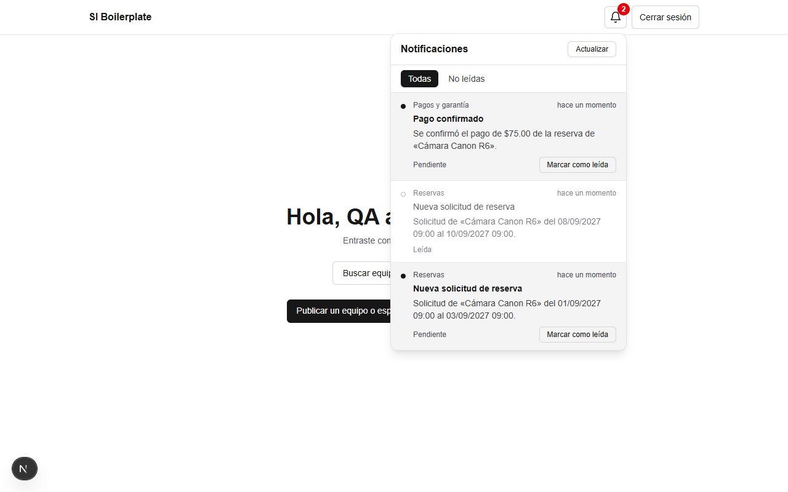
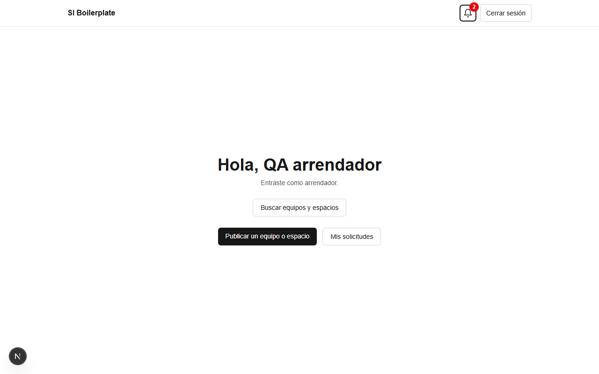
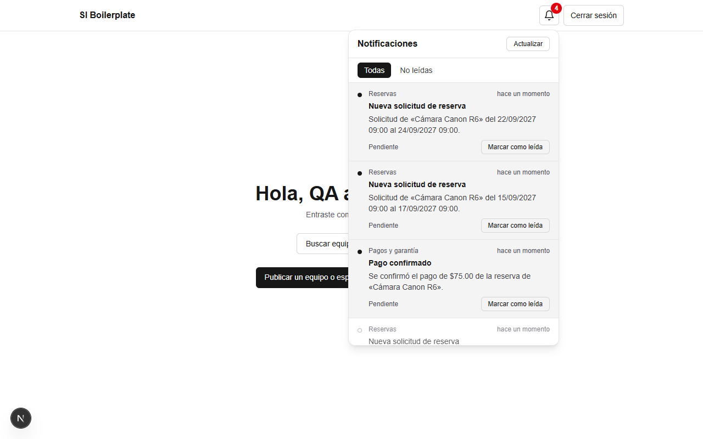
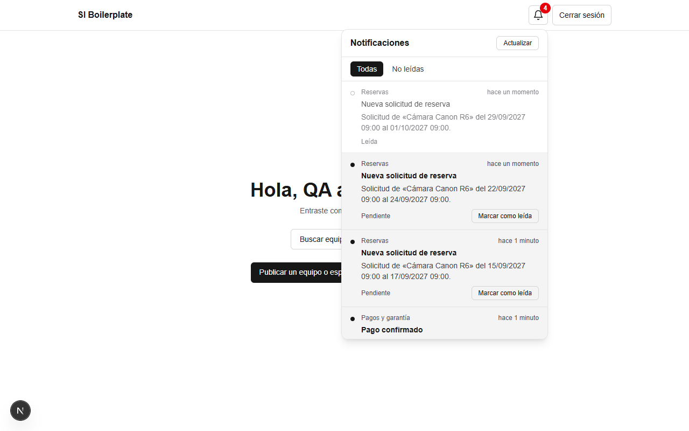
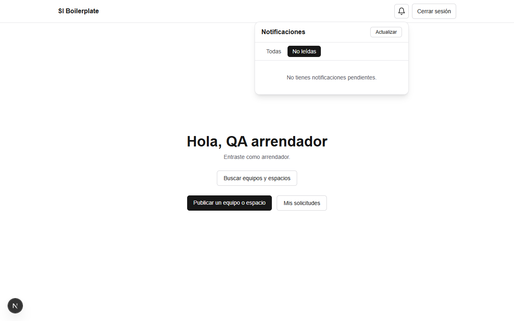
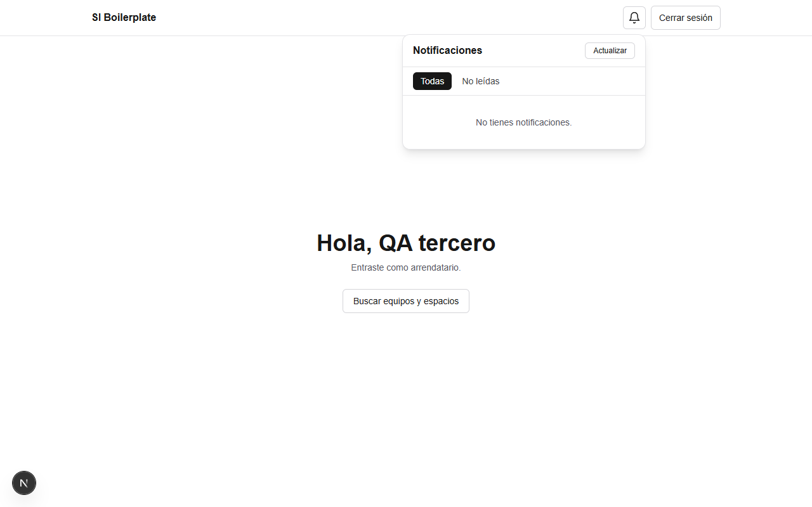
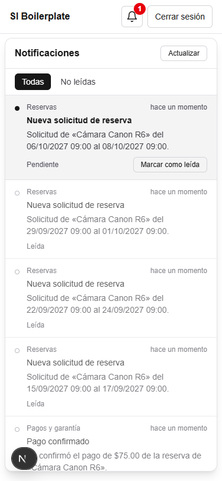

# QA-10.1. Pruebas de avisos, lectura y privacidad de la bandeja (MP4-110)

Historia: **H10. Consultar notificaciones de mi alquiler.**
Ejecutado el 20 de noviembre de 2026 contra:
- backend: `main` con BE-10.2 (PR #78, `e593d7c`);
- frontend: `main` con FE-10.1 (`11f8348`).

QA-10.1 aporta lo que no estaba cubierto: el recorrido de punta a punta
desde el lado del usuario (evento → aviso pendiente en la bandeja → contador
→ lectura → sigue en el historial como leído → el contador baja), la
privacidad entre usuarios y el comportamiento del frontend. No repite lo que
ya cubren:

- [`test/notifications.catalogo.e2e-spec.ts`](../../test/notifications.catalogo.e2e-spec.ts)
  (BE-10.2): la fila de cada aviso en la base (destinatario, título, mensaje,
  módulo y referencia), que repetir no duplica y el barrido de datos
  sensibles.
- [`test/notifications.bandeja.e2e-spec.ts`](../../test/notifications.bandeja.e2e-spec.ts)
  (BE-10.1): lista propia y orden, filtro, paginación, forma de la respuesta,
  PATCH (idempotente y simultáneo), ajena 404 con el mismo mensaje que una
  inexistente, conteo y 401. Usa avisos sembrados con Prisma, no eventos.
- [`test/qa/qa-20.1-avisos.e2e-spec.ts`](../../test/qa/qa-20.1-avisos.e2e-spec.ts):
  el servicio de avisos y los ejemplos del contrato.
- Las pruebas unitarias del frontend (`components/notificaciones/__tests__`),
  con mocks: intervalo de 30 s, «Actualizar», distinción visual y marcar como
  leída.

## Backend: casos automatizados

Archivo: [`test/qa/qa-10.1-avisos-bandeja.e2e-spec.ts`](../../test/qa/qa-10.1-avisos-bandeja.e2e-spec.ts).

Usuarios: A (arrendador), T (arrendatario) y X (un tercero, arrendatario).
Cada evento se genera con la operación real por HTTP y se mira desde la
bandeja (`GET /notificaciones`) y el contador
(`GET /notificaciones/no-leidas/conteo`) de cada usuario. En cada paso se
comprueba que el contador coincide con la bandeja: conteo = total de «no
leídas» = items sin leer de la lista completa.

| Id | Caso | Resultado |
|---|---|---|
| C01 | Una solicitud nueva aparece pendiente en la bandeja del arrendador y su contador sube 1; no aparece en la del arrendatario ni en la del tercero | ✅ |
| C02 | Al aprobar, «Reserva CONFIRMADA» aparece pendiente para el arrendatario; el arrendador no recibe nada por su propia decisión | ✅ |
| C03 | Al rechazar con motivo, «Reserva RECHAZADA» llega al arrendatario con el motivo | ✅ |
| C04 | Un pago rechazado deja «Pago rechazado» solo al arrendatario; el arrendador no recibe nada de ese intento | ✅ |
| C05 | Un pago aprobado deja «Pago aprobado» al arrendatario y «Pago confirmado» al arrendador, cada uno solo en su bandeja; el tercero no recibe nada | ✅ |
| C06 | Un mensaje nuevo avisa al otro participante en los dos sentidos; el autor nunca recibe el aviso de su propio mensaje | ✅ |
| C07 | Leer un aviso responde 200 con `leidaAt`; sigue en la lista completa con el mismo título y mensaje, sale de «no leídas» y el contador baja 1 | ✅ |
| C08 | Leerlo dos veces es idempotente: misma `leidaAt` y el contador no cambia | ✅ |
| C09 | El tercero intenta marcar un aviso del arrendador: 404 con el cuerpo idéntico al de un id inexistente; el aviso sigue pendiente, los contadores no cambian y el tercero no lo ve en su bandeja | ✅ |
| C10 | Sin sesión, la bandeja, el contador y el PATCH responden 401 y no se modifica nada | ✅ |
| C11 | Recorrido completo: solicitud → aprobación → pago aprobado → cada uno lee lo suyo; el contador sube y baja como corresponde, los leídos siguen en el historial y todo cuadra en cada paso | ✅ |
| C12 | Repetir la decisión (409) y el pago aprobado (409 `PAGO_YA_APROBADO`) no agrega avisos: un solo aviso por referencia en cada bandeja y los contadores no cambian | ✅ |

**Resultado: 12 de 12 casos pasan.**

## Frontend: casos en el navegador

Probado con Chrome headless (Playwright con el Chrome del sistema) contra el
backend y el frontend levantados en local, con una base aparte
(`si_be_qa_10_1`), nunca la de pruebas. El intervalo de 30 s se probó con el
reloj de Playwright (`page.clock`), sin esperar de verdad. Script:
[`evidencias/QA-10.1/qa-10.1-navegador.mjs`](evidencias/QA-10.1/qa-10.1-navegador.mjs).

Datos: un arrendador (A), un arrendatario (T) y un tercero (X); una cámara
publicada por A. Todos los avisos salen de operaciones reales: A empieza con
la solicitud de una reserva, el «Pago confirmado» de esa reserva (pendientes)
y otra solicitud ya leída.

Pantallas probadas: escritorio (1280×800) y móvil (375×812).

| Id | Caso | Resultado |
|---|---|---|
| P01 | La bandeja distingue pendientes y leídas: las pendientes tienen fondo, punto relleno, título en negrita (600), «Pendiente» y «Marcar como leída»; la leída se ve atenuada (opacidad 0.7), título normal (500), «Leída» y sin botón | ✅ |
| P02 | El contador (2) coincide con los pendientes de «Todas» (2) y con la lista de «No leídas» (2) | ✅ |
| P03 | Con la bandeja cerrada llega una solicitud nueva: a los 29 s el contador sigue en 2; a los 30 s pasa a 3 solo, sin recargar | ✅ |
| P04 | Con la bandeja abierta llega otra solicitud: la lista no cambia sola; «Actualizar» la trae arriba como pendiente y el contador pasa a 4, igual que los pendientes de la lista | ✅ |
| P05 | Con la bandeja abierta llega otro aviso y pasa el tick de 30 s: el contador y la lista deberían coincidir, pero el contador muestra **5** y la lista abierta sigue con **4 pendientes** (5 avisos) hasta pulsar «Actualizar». Ver **D01** | ❌ D01 |
| P06 | «Marcar como leída»: el aviso pasa a «Leída» y **sigue en la lista** (6 avisos antes y después), el contador baja de 5 a 4 y tras recargar la página sigue leído | ✅ |
| P07 | «No leídas» muestra tantos avisos como el contador (4) y no incluye el leído; al marcarlos todos el contador desaparece y, tras «Actualizar», dice «No tienes notificaciones pendientes.» | ✅ |
| P08 | El tercero entra: sin contador y «No tienes notificaciones.»; ningún id de A en su bandeja. Un PATCH a la ruta del frontend con un aviso de A, desde la sesión del tercero, responde 404 con el mismo cuerpo que un id inexistente, y el aviso de A sigue pendiente | ✅ |
| P09 | En móvil (375×812) la bandeja abierta entra completa (357 px) y no hay scroll horizontal (`scrollWidth` 375) | ✅ |
| P10 | No hay errores de JavaScript en la consola en las sesiones de A, del tercero ni en móvil | ✅ |

**Resultado: 9 de 10.** P05 no cumple lo esperado: es el defecto menor
**D01**. No hubo errores de JavaScript en la consola. El script compara en
P05 lo observado con lo esperado, lo marca «❌ D01 (defecto conocido, no
corregido)» y termina con «Resultado: 9 de 10.», igual que este documento.

P01: pendientes y leídas:



P03: el contador a los 29 s y a los 30 s:




P04: «Actualizar» trae el aviso nuevo:



P05 (D01): tick de 30 s con la bandeja abierta (contador 5, lista con 4 pendientes):


P06: marcada como leída, sigue en la lista:



P07: sin pendientes:



P08: el tercero no ve avisos ajenos:



P09: a 375 px:



## Criterios que cubre cada caso

Criterios técnicos de la ficha (MP4-110):

| Criterio | Backend | Frontend |
|---|---|---|
| Los eventos generan los avisos esperados | C01 a C06, C11, C12 | P03, P04 |
| Los avisos leídos se conservan marcados | C07, C08, C11 | P01, P06 |
| No se consulta ni modifica una notificación ajena | C09, C10 | P08 |
| El contador de no leídos coincide con la bandeja tras cada actualización | C01 a C12 (en cada paso) | P02, P04, P07 cumplen; P05 no, en el tick de 30 s con la bandeja abierta (**D01**) |

Criterios de negocio de H10:

| Criterio | Backend | Frontend |
|---|---|---|
| 1. Veo el resultado de mi solicitud (aprobación o rechazo) | C02, C03, C11 | — |
| 2. Encuentro el resultado del pago simulado de mi reserva | C04, C05, C11 | — |
| 3. Al marcar una como leída deja de aparecer como pendiente | C07, C08, C11 | P06, P07 |
| 4. No puedo consultar ni marcar una notificación ajena | C09, C10 | P08 |
| 5. El arrendador ve la solicitud nueva | C01, C11 | P01, P03, P04 |
| 6. El arrendador ve el pago confirmado | C05, C11 | P01 |
| 7. Veo el aviso de mensaje nuevo (H15 y H16) | C06 | — |
| 8. El contador se actualiza cada 30 s y con «Actualizar» | — | P03, P04 |
| Sin duplicados al reintentar | C12 | — |
| Permisos de cada rol | C01 a C06, C09, C10 | P08 |

## Defectos encontrados

Un defecto menor, identificado y **no corregido** en esta task.

### D01. El tick de 30 s actualiza el contador pero no la bandeja abierta

| Campo | Valor |
|---|---|
| Severidad | Baja |
| Componente | Frontend, FE-10.1 (`components/notificaciones/icono-notificaciones.tsx` y `bandeja-notificaciones.tsx`) |
| Criterio afectado | «El contador de no leídos coincide con la bandeja tras cada actualización», en la actualización automática cada 30 s |
| Caso | P05 |
| Estado | Identificado, no corregido |

**Pasos para reproducir:**
1. Entrar como un usuario con avisos pendientes (en P05, el arrendador con 4).
2. Abrir la bandeja con la campana y dejarla abierta.
3. Desde otra sesión, generar un aviso para ese usuario (por ejemplo, que un
   arrendatario solicite una reserva de su bien).
4. Esperar el tick de 30 s del contador sin pulsar «Actualizar».

**Resultado observado:** el contador del encabezado muestra **5** y la
bandeja abierta sigue con **4 pendientes** (5 avisos); el aviso nuevo no
aparece. Los dos solo vuelven a coincidir (5 y 5) al pulsar «Actualizar».

**Resultado esperado:** después del tick, el contador y los pendientes de la
bandeja abierta coinciden, sin que haga falta pulsar «Actualizar».

**Arreglo sugerido:** que el tick de 30 s también recargue la lista cuando la
bandeja está abierta (por ejemplo, que `IconoNotificaciones` avise a
`BandejaNotificaciones` en cada tick, igual que hoy hace «Actualizar» con su
recarga). Con la bandeja cerrada basta con el contador, como ahora.

Evidencia: [P05](evidencias/QA-10.1/P05-tick-con-bandeja-abierta.png).

## Observaciones

- **No existe un endpoint para consultar una notificación por id.** La API
  de la bandeja tiene la lista, el PATCH de lectura y el conteo. «Consultar
  una ajena» (H10, criterio 4) se probó como: no aparece en la bandeja de
  otro usuario y el PATCH responde igual que con un id inexistente (C09, P08).
  No hay fuga: el 404 es `{"message":"La notificación no existe.","error":"Not Found","statusCode":404}`
  en los dos casos.
- **H10 tiene 8 criterios de negocio**, aunque la ficha de MP4-110 habla de
  los criterios 1 a 9 (`docs/briefs/miguel.md`).
- El arrendatario recibe «Pago aprobado» y el arrendador «Pago confirmado»
  por el mismo pago, como pide H05 (criterio 8).
- En «No leídas», un aviso que se marca como leído se queda a la vista,
  atenuado, hasta pulsar «Actualizar» o cambiar de filtro (P07). Es lo que
  hace FE-10.1 a propósito para no mover la lista mientras se lee.
- Chrome registra en la consola «Failed to load resource: 404» cuando una
  petición responde 404, aunque la app lo maneje. En la primera corrida los
  dos PATCH a propósito de P08 aparecían así en P10; se movieron a
  `context.request` (misma sesión del tercero, fuera de la página) para que
  P10 revise solo lo que hace la app.

## Cómo repetirlo

```bash
# 1. Migraciones en la base de pruebas
DATABASE_URL="postgresql://postgres:<clave>@localhost:5432/si_be_boilerplate_test?schema=public" npx prisma migrate deploy

# 2. Las pruebas, con TEST_DATABASE_URL (nombre completo, ya con _test) y sin
#    definir DATABASE_URL en el comando
TEST_DATABASE_URL="postgresql://postgres:<clave>@localhost:5432/si_be_boilerplate_test?schema=public" \
  npx vitest run --config ./vitest.config.e2e.ts test/qa/qa-10.1-avisos-bandeja.e2e-spec.ts --reporter=verbose
```

Para el frontend, los pasos completos están en el comentario de
[`qa-10.1-navegador.mjs`](evidencias/QA-10.1/qa-10.1-navegador.mjs):
1. Crea una base aparte (`si_be_qa_10_1`) y aplícale las migraciones.
2. Levanta el backend de `main` contra esa base en el puerto 3101.
3. Levanta el frontend de `main` en el puerto 3100 con `API_URL` apuntando a
   ese backend.
4. Instala `playwright-core` fuera de los repos y corre el script; deja las
   capturas en `docs/qa/evidencias/QA-10.1/`.
5. Borra la base al terminar.

## Revisión

Los criterios de aceptación los revisa otro integrante del equipo en el PR.

| Revisor | Fecha | Resultado |
|---|---|---|
| | | |
